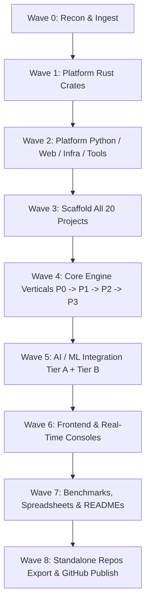

# Portfolio Forge: 20-Project Master Execution Plan (PLAN.md)

**Portfolio Goal**: Build 20 industry-grade, production-ready distributed systems and backend engines in one shared-core monorepo with verified benchmarks, zero stubs, zero unmeasured claims, and clean standalone exportability.

---

## 1. Wave Architecture & Gating Strategy

### Wave Progression & Quality Gates

1. **Wave 0: Recon & Ingestion (CURRENT)**
   - Parse all 20 workbooks via `tools/feature-ingest` into canonical `spec/features.jsonl`.
   - Output `docs/REUSE_MAP.md`, `docs/PLAN.md`, `docs/DECISIONS.md`, `docs/REFERENCES.md`, and initial `PORTFOLIO_STATE.md`.
   - *Gate*: 100% of workbooks parsed, total feature count verified (800 features across 20 projects).

2. **Wave 1: Platform Rust Crates**
   - Implement the 19 `pf-*` crates in `platform/rust/crates/` with comprehensive unit, property (`proptest`), and fuzz tests.
   - Run Criterion microbenchmarks across all data structures, encoders, and SIMD kernels.
   - *Gate*: `make ci` on `platform/rust` passes with 0 warnings, zero memory leaks, and recorded baseline benchmarks.

3. **Wave 2: Platform Python ML, Web Packages, Infra & Generator Tools**
   - Implement `pf_ml` (synthetic data, anomaly detection, Kalman filters, guardrails, LLM provider).
   - Implement `@pf/ui-kit`, `@pf/scroll3d`, `@pf/viz`, and `@pf/realtime-client`.
   - Implement generator tools: `tools/scaffold`, `tools/sheet-gen`, `tools/readme-gen`, `tools/frames-gen`, `tools/export-project`, `tools/dedupe-scan`, `tools/state-writer`.
   - *Gate*: Scaffold a throwaway test project end-to-end; verify clean export and `make ci` pass.

4. **Wave 3: Scaffold All 20 Projects**
   - Execute `tools/scaffold` across all 20 projects to generate folder layouts, Makefiles, Dockerfiles, Next.js shells, API skeletons, and initial sheets.
   - *Gate*: All 20 projects build cleanly in workspace; status updated to `Scaffolded`.

5. **Wave 4: Core Engine Implementations (P0 -> P1 -> P2 -> P3)**
   - Implement core state machines, concurrency primitives, wire protocols, and storage kernels for each project in priority order.
   - Run `tools/dedupe-scan` at the end of each batch; promote duplicates >30 lines to `platform/`.
   - *Gate*: Unit + property + simulation tests passing with 0 `todo!()` or `unimplemented!()` stubs.

6. **Wave 5: AI / ML Layer (Tier A + Tier B)**
   - Implement project-specific predictive models (Tier A) with non-ML baselines and offline evaluation.
   - Implement diagnostic assistant layer (Tier B) with mock providers and schema-validated JSON outputs.
   - *Gate*: Offline evaluation metrics recorded in `ml/metrics/*.json`; heuristic mode functions without network or GPU dependencies.

7. **Wave 6: Frontend & Real-Time Consoles**
   - Build Next.js 14 interactive consoles with real backend WebSocket / SSE streams.
   - Generate procedural 3D frame sequences for cinematic landing hero sections.
   - *Gate*: Next.js production build passes; Lighthouse performance >= 90; real-time telemetry streaming confirmed.

8. **Wave 7: Empirical Benchmarking, Spreadsheets & In-Depth Documentation**
   - Execute Criterion benchmarks, load harnesses, and stress tests; record raw JSON output in `benchmarks/results/`.
   - Generate synchronized Excel workbooks (`spreadsheets/NN-slug-features.xlsx`) and comprehensive 20–30 page READMEs with zero unmeasured claims.
   - *Gate*: All performance claims in README link directly to timestamped results files.

9. **Wave 8: Standalone Export, Verification & GitHub Publishing**
   - Execute `tools/export-project` to produce clean standalone repositories with vendored platform dependencies.
   - Verify `make ci` on each exported repo in a clean sandbox.
   - Push to GitHub under user `AVISHJAIN9` and update `PORTFOLIO_STATE.md`.

---

## 2. Project Priority Triage Matrix

Projects are ordered by architectural interest and user priority score:

| Rank | ID | Project Slug | Priority Score | Core Architectural Focus |
|---|---|---|---|---|
| **1** | `01` | `rollback-netcode-server` | **9.3** | Deterministic simulation, rollback resimulation, fixed-point math, UDP framing. |
| **2** | `09` | `distributed-cache` | **9.1** | Ultra-low latency S3-FIFO / TinyLFU cache, Ketama consistent hashing, seqlock. |
| **3** | `02` | `hnsw-filtered-vector-index`| **9.0** | SIMD vector kernels, hierarchical navigable small world graph, bitset filtering. |
| **4** | `05` | `mini-quic` | **8.9** | IETF QUIC framing, loss detection, congestion control (CUBIC/BBR), stream flow. |
| **5** | `11` | `zanzibar-authz` | **8.9** | ReBAC graph traversal, Zookie consistency tokens, Leopard indexing, Leopard cache. |
| **6** | `12` | `ll-hls-origin` | **8.9** | Sub-second CMAF video chunk packaging, byte-range delivery, ABR rate controller. |
| **7** | `06` | `lsm-kv-engine` | **8.5** | Log-structured merge tree, write-ahead log, Bloom filters, leveled compaction. |
| **8** | `04` | `columnar-query-engine` | **8.0** | Vectorized columnar execution, Arrow memory buffers, Parquet decoder, learned stats. |
| **9** | `07` | `stream-detect-engine` | **8.0** | Real-time sliding window complex event processing (CEP), behavioral anomaly detection. |
| **10**| `10` | `crdt-rich-text-editor` | **8.0** | Conflict-free replicated data types, causal tree replication, hybrid logical clocks. |
| **11**| `08` | `pubsub-broker` | **7.9** | Segmented commit log, partitioned topics, zero-copy socket sends, consumer groups. |
| **12**| `20` | `notification-delivery-platform` | **7.9** | Multi-channel dispatch, priority pacer, rate limiters, token-bucket backpressure. |
| **13**| `17` | `cdn-caching-proxy` | **7.8** | Edge HTTP/3 reverse proxy, tiered SSD/memory caching, stampede protection. |
| **14**| `13` | `ledger-engine` | **7.5** | Immutable double-entry journal, cryptographic hash chain, balance invariants. |
| **15**| `14` | `tracing-backend` | **7.5** | High-throughput OTel span ingest, columnar trace storage, trace DAG reconstruction. |
| **16**| `16` | `rate-limit-gateway` | **7.0** | Atomic GCRA rate limiter, distributed token bucket, sliding window counter. |
| **17**| `19` | `usage-billing-engine` | **6.75** | Event metering aggregation, high-throughput deduplication, rating engine. |
| **18**| `15` | `llm-inference-scheduler` | **6.0** | Continuous batching scheduler, PagedAttention KV-cache manager, prefix caching. |
| **19**| `18` | `flash-sale-inventory` | **5.5** | High-contention atomic inventory decrement, anti-overselling queue, bot triage. |
| **20**| `03` | `bytecode-vm-gc` | **4.0** | Register-based bytecode VM, mark-sweep generational garbage collector. |
