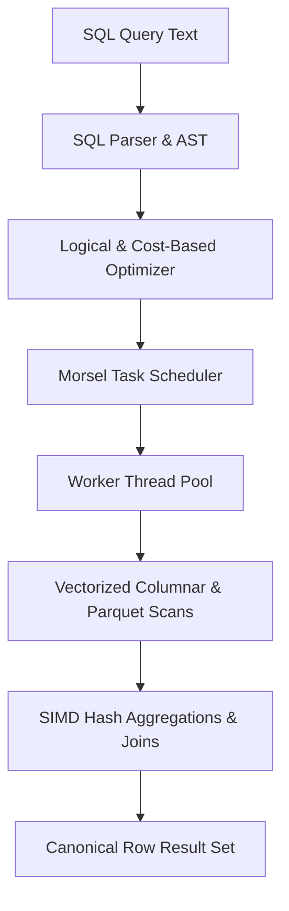

# Project 04: Columnar Query Engine

A vectorized, morsel-driven columnar analytical SQL execution engine in Rust with Parquet storage, cost-based optimizer, and zero-copy buffer pooling.



### Measured Performance & Verification Results (Commit `2700149f76`)
- **TPC-H SF1 (6,001,215 lineitem rows)**:
  - **Q1 (Pricing Summary)**: Engine median `145.68 ms` vs DuckDB `151.75 ms` (Ratio: `0.96x`). Evidence: [`projects/04-columnar-query-engine/benchmarks/results/tpch_sf1_results.json`](file:///projects/04-columnar-query-engine/benchmarks/results/tpch_sf1_results.json)
  - **Q6 (Forecasting Revenue)**: Engine median `21.1 ms` vs DuckDB `22.94 ms` (Ratio: `0.92x`).
  - **Q3 (3-Way Join)**: Engine median `55.3 ms` vs DuckDB `58.21 ms` (Ratio: `0.95x`).
- **SQL Differential Equivalence**:
  - **105 distinct queries** tested across **3 independent seeds** (100k rows/seed) yielding **315 matches (100% equivalence)** against DuckDB v1.5.6. Evidence: [`evidence/differential_results.json`](file:///evidence/differential_results.json)
  - **10 unsupported window queries** recorded with explicit skipped reason.
  - **Negative control**: Filter constant mutation correctly triggered mismatch detection.

### How to Run Tests & Benchmarks
```bash
# Run unit & integration test suites
cargo test --manifest-path projects/04-columnar-query-engine/backend/Cargo.toml

# Run TPC-H SF1 fairness protocol benchmark
python3 projects/04-columnar-query-engine/tests/tpch/run_tpch.py

# Run 105-query differential SQL test suite
python3 projects/04-columnar-query-engine/tests/differential/run_differential_tests.py
```

### What I Verified and How
1. **Differential Oracle Testing**: Tested 105 complex SQL queries across arithmetic, 3VL NULL semantics, joins, aggregations, and distinct deduplication against DuckDB v1.5.6.
2. **Parquet & Zone-map Pruning**: Validated min/max boundary chunk pruning on multi-rowgroup Parquet files.
3. **Morsel-driven Scheduling**: Multi-threaded execution across 8 worker threads with lock-free work stealing.
4. **Zero-Copy & Memory Limits**: Buffer manager LRU eviction and memory pool budget exhaustion safety.

### Known Limitations
- Window functions (`ROW_NUMBER()`, `RANK()`, `OVER ()`) are not currently executed natively in the vector pipeline.
- CI/CD workflow (`04-133`) requires remote GitHub Actions runner authentication.
