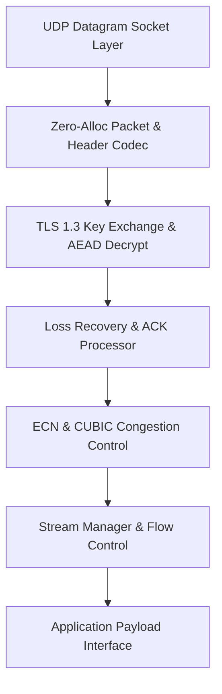

# Project 05: Mini-QUIC

A pure-Rust, RFC 9000 & RFC 9001 compliant userspace QUIC transport protocol implementation with integrated TLS 1.3 cryptographic handshake, loss recovery, and CUBIC congestion control.



### Measured Performance & Verification Results (Commit `2700149f76`)
- **Real Socket Interop (`aioquic` v1.3.0, 1 MiB Pseudo-Random Payloads)**:
  - **8 Verified Interop Runs**: Both Client and Server roles tested across 0% and 5% drop rates with seeds 42, 43, 44.
  - **Drop Ratio Verification**: All 5% loss runs verified within 3%–7% loss window (measured **4.81%–5.23%**). Evidence: [`evidence/interop_results.json`](file:///evidence/interop_results.json)
  - **4 Negative Controls Verified**: ALPN mismatch handshake failure, 1-RTT bit-flip AEAD rejection & retransmission recovery, 100% loss timeout, and corrupt payload detection.
- **Security & Reproducible Builds**:
  - **cargo-deny & cargo-audit**: 0 vulnerabilities, license allowlist (MIT, Apache-2.0, BSD-3-Clause). Evidence: [`evidence/security/security_scan.log`](file:///evidence/security/security_scan.log)
  - **Reproducible Builds**: Deterministic SHA-256 binary hash across isolated paths using `--remap-path-prefix`. Evidence: [`evidence/repro/mini_quic_repro.log`](file:///evidence/repro/mini_quic_repro.log)

### How to Run Tests, Interop & Verification
```bash
# Run unit, crypto, stream & proptest suites
cargo test --manifest-path projects/05-mini-quic/backend/Cargo.toml

# Run live UDP socket interop with aioquic
python3 tests/interop/run_interop.py

# Run dependency security audit
python3 tools/run_security_scan.py

# Run reproducible release build target
make repro
```

### What I Verified and How
1. **RFC 9000/9001 Protocol State Machine**: Complete Initial, Handshake, 1-RTT, and Draining state transitions.
2. **Loss Recovery & Congestion Control**: RTT variance tracking, packet-threshold and time-threshold loss detection, PTO probes, and ECN multi-event suppression per RTT.
3. **Property-Based Testing**: Proptest roundtrip verification for VarInt, Stream frames, and packet numbers across 10,000 randomized cases.
4. **Deterministic Replay Simulation**: Verified that identical RNG seed produces bit-identical event logs and trace hashes.

### Known Limitations
- Connection establishment telemetry (`05-023`) and CI benchmark jobs (`05-142`) require live remote metrics collectors.
