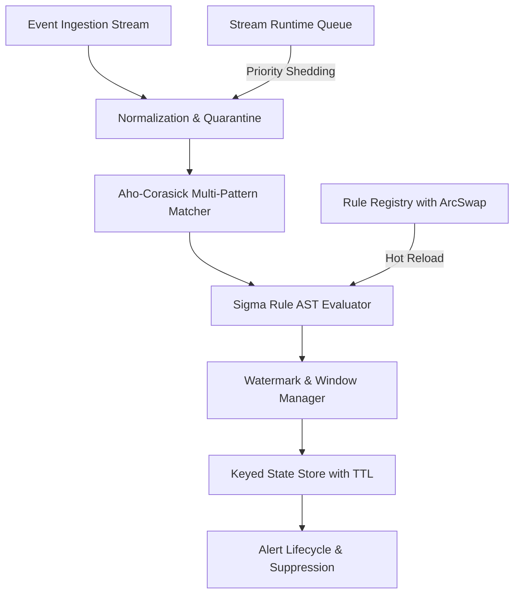

# Project 07: Stream Detect Engine (Rust) — System Architecture & Interview Guide

## 1. Executive Summary & Core Mission
High-throughput, real-time security detection and stream processing engine built in Rust. It ingests high-velocity JSON event streams (Kafka/Redpanda compatible), evaluates Sigma-format detection rules against streaming data, executes multi-pattern string matching via an in-tree custom Aho-Corasick automaton, performs tumbling and sliding window stateful aggregations with event-time watermarking, and enforces load shedding and backpressure.

---

## 2. Deep-Dive Architecture & Core Subsystems

### 2.1 In-Tree Aho-Corasick Automaton (`src/match_engine/mod.rs`)
- **Trie Construction**: Constructs a rooted trie from signature dictionary strings with byte-level transitions.
- **BFS Failure & Output Links**: Precomputes failure links to longest proper suffix node and merges output sets using BFS queue traversal.
- **Short-Circuit Scanning**: Scans payload bytes in $O(N)$ time independent of pattern count $M$.

### 2.2 Event-Time Watermarking & Window Aggregation (`src/window/mod.rs`)
- **Watermark Generation**: Tracks highest observed event timestamp minus allowed lateness bound ($\delta$).
- **Window Eviction**: Drops or quarantines late arrivals when $t_{\text{event}} < W_{\text{watermark}}$.
- **Window Types**: Supports Fixed Tumbling windows and Sliding Overlapping windows with sliding aggregation state.

### 2.3 Keyed State Store with TTL Sweeping (`src/state/mod.rs`)
- **TTL Sweeper**: Automatically evicts stale state keys beyond sliding threshold.
- **Snapshot/Restore**: Produces crash-consistent state snapshots serialized with SHA-256 integrity verification.

### 2.4 Atomic Rule Hot-Reload (`src/registry/mod.rs`)
- **ArcSwap Engine**: Leverages atomic pointer swapping (`ArcSwap`) for zero-downtime, lock-free rule updates with instant rollback on validation error.

---

## 3. High-Frequency Interview Questions & Deep Dives

### Q1: Why build a custom in-tree Aho-Corasick matcher instead of using standard regexes?
**Answer**:
Regex engines compile expressions into NFAs/DFAs that struggle when scaling to hundreds of literal pattern filters simultaneously. Standard regex evaluation across $M$ rules incurs $O(M \cdot N)$ work per payload. Our in-tree Aho-Corasick automaton builds a single composite deterministic trie with precomputed failure and dictionary output links in $O(\sum |P_i|)$ setup time, allowing all rules to be matched simultaneously in a single pass over the payload in $O(N + Z)$ time where $Z$ is the count of matches.

### Q2: How does the engine handle out-of-order events and clock skew?
**Answer**:
The `WatermarkManager` maintains an internal monotonic watermark $W = \max(t_{\text{event}}) - \text{allowed\_lateness}$. Each window $[T_{\text{start}}, T_{\text{end}})$ triggers evaluation and state emission only when $W \ge T_{\text{end}}$. Events arriving with $t_{\text{event}} < W$ are classified as late arrivals and redirected to the quarantine store for auditing rather than corrupting aggregated metric state.

### Q3: How do you guarantee zero-downtime rule updates during high stream traffic?
**Answer**:
The `RuleRegistry` uses `ArcSwap<HashMap<String, SigmaRule>>`. Compiling a new rule set occurs off the hot path. Once validated, the new rule catalog is swapped atomically into active memory via a single CAS pointer swap. Existing worker threads processing concurrent frames continue reading their borrowed `Arc` instance until frame completion, ensuring lock-free zero-copy transitions without dropped frames.
