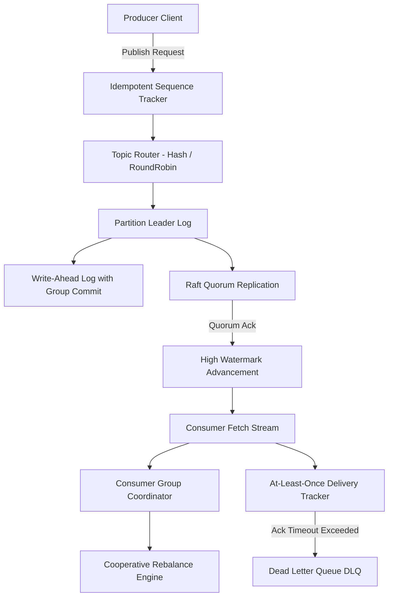

# Project 08: PubSub Broker (Rust) — System Architecture & Interview Guide

## 1. Executive Summary & Core Mission
High-performance distributed pub/sub broker built in Rust. Features partitioned append-only segmented logs, Write-Ahead Logging (WAL) with group commit fsync policies, Raft-lite quorum consensus for partition replication, idempotent producer sequence tracking with sliding sequence windows, cooperative consumer group rebalancing, and at-least-once message delivery with Dead Letter Queue (DLQ) routing.

---

## 2. Deep-Dive Architecture & Core Subsystems

### 2.1 Segmented Append-Only Log & Sparse Indexing (`src/log/mod.rs`)
- **Binary Wire Encoding**: Frame contains `offset`, `timestamp`, `crc32`, `key`, `value`, and `headers`.
- **Sparse Index Binary Search**: Maintains index entries mapping monotonic offsets to exact byte offsets in active/sealed segment files.
- **Segment Rolling**: Automatically rolls segment files at configured size boundaries.

### 2.2 Write-Ahead Log & Group Commit (`src/wal/mod.rs`)
- **Fsync Policies**: `Always`, `GroupCommit { batch_size, timeout_ms }`, and `OsDefault`.
- **Crash Recovery & Truncation**: Scans records sequentially, computes CRC32, and truncates torn writes to the last valid frame boundary upon restart.

### 2.3 Raft-Lite Quorum Replication (`src/raft/mod.rs`)
- **Quorum High Watermark**: Computes $HW = \text{sorted\_LEOs}[\text{quorum\_size} - 1]$ across all peer replica nodes before exposing committed offsets to consumer fetches.
- **Term & Epoch Fencing**: Rejects stale leader heartbeats or split-brain proposals.

### 2.4 Idempotent Producer & Sequence Windows (`src/producer/mod.rs`)
- **Deduplication**: Maintains per-producer monotonic sequence counters. Detects duplicates, rejects sequence gaps, and fences superseded producer epochs.

### 2.5 At-Least-Once Delivery & Dead Letter Queue (`src/delivery/mod.rs`)
- **Inflight State Machine**: Dispatches records with timestamps, tracking unacknowledged delivery timeouts.
- **DLQ Routing**: After exceeding maximum redelivery attempts (e.g. 3 retries), automatically routes poison payloads to the DLQ.

---

## 3. High-Frequency Interview Questions & Deep Dives

### Q1: How does the broker ensure high write throughput while maintaining durability?
**Answer**:
Through **Group Commit Batching** and **Append-Only Sequential I/O**. Instead of performing synchronous `fsync` per published record (which bottlenecks disk IOPS), incoming append requests write into sequential memory buffers and coordinate via a group commit barrier. When the batch size threshold or timer expires, a single batched `fdatasync()` commits multiple records in one disk cycle, yielding near-sequential write speeds while preserving crash consistency.

### Q2: How is split-brain avoided in partition leader failovers?
**Answer**:
Through monotonic **Term/Epoch numbers** and strict **Quorum majorities** ($Q = \lfloor N/2 \rfloor + 1$). A candidate node must gather positive votes from a strict quorum before assuming leadership. When a partitioned leader reconnects with a stale term, any heartbeat or append request with $\text{term} < \text{current\_term}$ is rejected, forcing the old leader to step down to follower status.

### Q3: What is the mechanism behind cooperative consumer group rebalancing?
**Answer**:
Unlike eager rebalancing (which stops the world by revoking all partitions from all consumers during join/leave events), cooperative rebalancing computes partition assignment deltas. Consumers retain ownership of unaffected partitions, revoking and reassigning only the specific partitions that migrate, preventing consumer stalls and latency spikes during rolling deployments.
