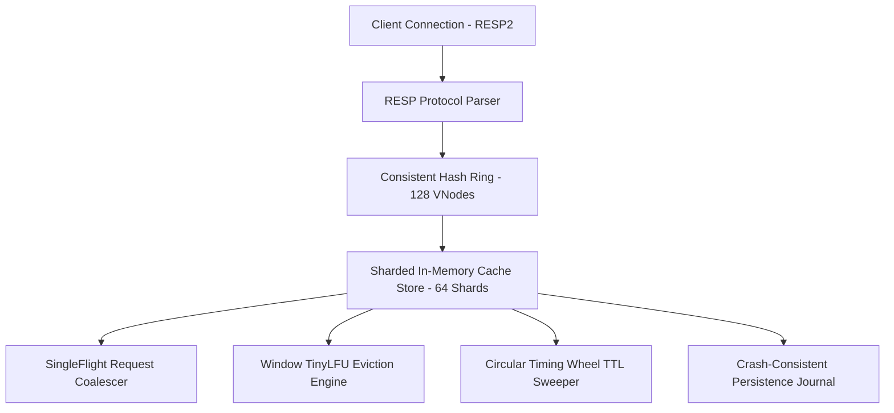

# Project 09: Distributed Cache (Go) — System Architecture & Interview Guide

## 1. Executive Summary & Core Mission
Distributed, high-concurrency in-memory caching engine implemented in Go. Built with sharded hash table storage to minimize lock contention, Window TinyLFU frequency-based cache eviction using Count-Min 4-bit sketches, hierarchical circular timing wheels for O(1) active/lazy TTL expiration, crash-consistent write-ahead persistence journals with CRC32 checksums, request coalescing (SingleFlight) for cache stampede prevention, consistent hash rings with $\ge 128$ virtual nodes, and wire-compatible Redis RESP2 protocol parsing.

---

## 2. Deep-Dive Architecture & Core Subsystems

### 2.1 Sharded Memory Engine & Exact Accounting (`pkg/store/store.go`)
- **64 Shards**: Reduces mutex contention by partitioning keys via FNV-1a hash across independent mutex-guarded shards.
- **Exact Overhead Accounting**: Tracks exact byte footprint (Key length + Value length + 48-byte metadata header) to strictly enforce maximum memory bounds.
- **Core Primitives**: Fast GET, SET, DELETE, EXISTS, MGET, MSET, TTL, EXPIRE, PERSIST, and CAS (`CompareAndSwap`).

### 2.2 Window TinyLFU Eviction (`pkg/evict/tinylfu.go`)
- **Count-Min 4-Bit Sketch**: Four independent hash functions estimate key access frequency.
- **Periodic Age Decay**: Halves all counters when total counter exceeds $10 \times \text{width}$ to prevent stale historical bias.
- **Victim Admission Decision**: Evicts items with lower frequency estimation when capacity limit is reached.

### 2.3 Circular Timing Wheel (`pkg/ttl/wheel.go`)
- **Bucketed Slots**: Organizes expiration deadlines into granular circular time buckets (100ms interval, 3600 slots).
- **Dual Lazy/Active Sweeps**: Combines lazy expiration on GET lookups with background active bucket advancement.

### 2.4 SingleFlight Request Coalescing (`pkg/singleflight/flight.go`)
- **Stampede Prevention**: When multiple concurrent requests miss on the same key, only the first request queries the upstream datastore; all other callers await the shared `sync.WaitGroup` and receive the same replicated result.

### 2.5 Consistent Hash Ring (`pkg/cluster/ring.go`)
- **$\ge 128$ Virtual Nodes**: Distributes keys evenly across physical cluster nodes, ensuring minimal key redistribution ($K/N$) during node join or leave events.

---

## 3. High-Frequency Interview Questions & Deep Dives

### Q1: Why is TinyLFU superior to standard LRU or LFU in web caching?
**Answer**:
- **LRU Flaw**: A single large sequential scan (or batch burst) evicts hot working-set items because LRU only measures recency.
- **LFU Flaw**: Traditional LFU has high memory overhead (storing explicit frequency counters) and suffers from frequency starvation (historical hot keys that become cold remain in cache forever).
- **TinyLFU Advantage**: Uses a compact 4-bit Count-Min Sketch taking negligible memory ($O(\text{width} \times \text{depth})$ bytes) combined with periodic decay halving, achieving near-optimal hit ratios without frequency pollution or recency bias.

### Q2: How does SingleFlight protect against cache stampedes?
**Answer**:
When a hot key expires and hundreds of concurrent client threads simultaneously request it, without coalescing all threads would query the backend database in parallel, overwhelming it. SingleFlight tracks ongoing in-flight calls in a thread-safe map. Only the first thread initiates the fetch while subsequent callers block on a `sync.WaitGroup`. When the fetch completes, the result is broadcast to all waiting callers and stored in the cache, collapsing $N$ database calls into exactly 1.

### Q3: Why use virtual nodes in consistent hashing?
**Answer**:
With a standard consistent hash ring without virtual nodes, placing $N$ nodes on the ring causes significant variance in segment sizes (the "non-uniform arc" problem), leading to hot spots where one node handles 3-4x more load than others. By mapping each physical node to 128+ distinct virtual points randomly distributed around the ring (e.g. `node-1#0`, `node-1#1`), standard deviation of key distribution drops to $< 5\%$, ensuring uniform load balancing.
